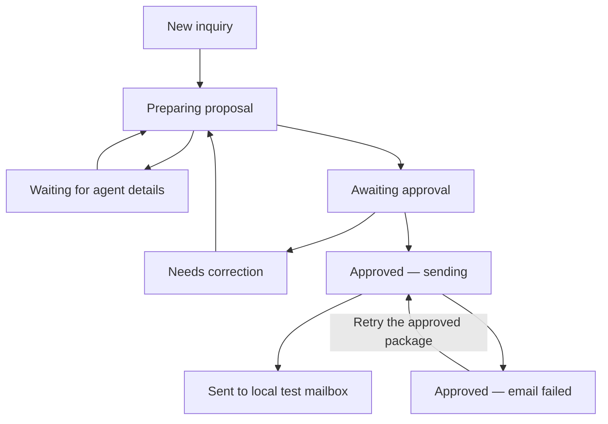
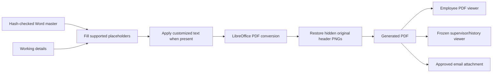
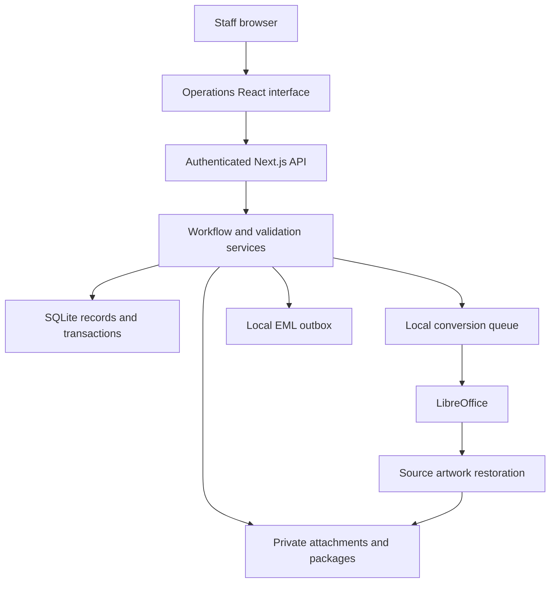

# RMC2 Franchising System — Project Guide

**Documentation date:** October 16, 2026 · Asia/Manila

**Application package:** `rmc2-franchising-system`, version `0.2.0`

**Current stage:** Working localhost application with server persistence and simulated external integrations

**Local address:** <http://127.0.0.1:5173/>

This document describes the franchising application we have built, its business rules, how to operate and test it, and the work remaining before production. It distinguishes implemented features from proposed integration and hosting work. It is based on the active application code, supplied template catalog, and recent verification results.

## Contents

1. [Project purpose](#project-purpose)
2. [Current implementation](#current-implementation)
3. [People and permissions](#people-and-permissions)
4. [Screens and navigation](#screens-and-navigation)
5. [Inquiry workflow](#inquiry-workflow)
6. [Exclusive handling and draft recovery](#exclusive-handling-and-draft-recovery)
7. [Submitted forms and autofill](#submitted-forms-and-autofill)
8. [Proposal library](#proposal-library)
9. [Standard and customized proposals](#standard-and-customized-proposals)
10. [Proposal assistance and detail checks](#proposal-assistance-and-detail-checks)
11. [Document generation and consistent PDFs](#document-generation-and-consistent-pdfs)
12. [Approval, email and history](#approval-email-and-history)
13. [Architecture and source map](#architecture-and-source-map)
14. [Data and file storage](#data-and-file-storage)
15. [API reference](#api-reference)
16. [Local setup and operation](#local-setup-and-operation)
17. [Testing and acceptance](#testing-and-acceptance)
18. [Troubleshooting](#troubleshooting)
19. [Live integrations](#live-integrations)
20. [Hosting options](#hosting-options)
21. [Backups and maintenance](#backups-and-maintenance)
22. [Production readiness and next milestones](#production-readiness-and-next-milestones)
23. [Business rules to preserve](#business-rules-to-preserve)

## Project purpose

The system gives RMC2 Consultancy Corporation a shared workspace for turning an agent's franchise inquiry into a reviewed proposal and an agent reply.

The intended process is:

1. Receive and retain the agent's submitted form.
2. Review the account, contact and coverage information.
3. Let one staff member handle the inquiry while colleagues can view it.
4. Choose an appropriate supplied proposal template.
5. Fill the proposal from the form, or create a clearly identified customized copy.
6. Check the document and prepare the PDF and email.
7. Submit a frozen version for supervisor review.
8. Return it for correction or approve it.
9. Deliver the approved proposal and retain its exact documents, decision and history.

The main benefits are less repeated typing, visible ownership, easier draft recovery, fewer differences between document views, and a traceable approval process.

The current application covers inquiry preparation and proposal approval. It does not implement a separate executed-contract lifecycle, electronic signatures, policy issuance, premium collection or an underwriting decision engine. Editing proposal conditions in a customized copy does not create those additional systems.

## Current implementation

| Area | Current behavior | Status |
| --- | --- | --- |
| Staff login | Seeded staff accounts, hashed passwords and server sessions | Implemented for local testing |
| Shared inquiries | Records stored on the server and visible to authenticated staff | Implemented |
| Exclusive handling | One current handler can edit; colleagues can view | Implemented |
| Excel intake | Reads the supported franchise workbook layout | Implemented |
| PDF intake | Preserves and displays the original PDF; working fields are entered manually | Implemented; no OCR |
| Sample forms | Branded sample workbook generated from original sample intake values | Implemented and labeled Sample |
| Template selection | Suggestions, selected-card highlighting, previews and family browsing | Implemented |
| Standard proposal editing | Supported autofill fields can be changed in text boxes | Implemented |
| Customized proposals | Direct paragraph and table-cell text editing with formatting controls | Implemented |
| Detail checks | Compares working values with the original form and validates supported rules | Implemented |
| AI recommendations | Rules based on the submitted fields and supplied catalog | Simulated; no live model |
| PDF generation | LibreOffice conversion with correction for hidden source header artwork | Implemented locally |
| Supervisor approval | Versioned review, return notes, flags and customized-content acknowledgment | Implemented |
| Email delivery | Creates a local `.eml` message containing the exact approved PDF | Simulated delivery; no external send |
| Notifications and history | Intake notices, reminders, approval outcomes and audit entries | Implemented |
| Hosted database/storage | Current records and files remain on this computer | Supabase not connected |
| Hosting | Local Node server | Production hosting undecided |

**A local “Sent” status means the approved reply was saved to the local test mailbox. It does not mean Gmail delivered a message.** The Integrations screen describes the current connection status; it is not a live credential setup flow.

## People and permissions

### Roles

| Action | Employee | Supervisor | Admin |
| --- | --- | --- | --- |
| View shared inquiries and documents | Yes | Yes | Yes |
| Import an agent form | Yes | No in the current workflow | Yes |
| Start handling an editable inquiry | Yes | Yes | No |
| Edit, select, customize, save or generate | While holding the handling lock | While holding the handling lock | No |
| Submit a proposal for review | While holding the handling lock | While holding the handling lock | No |
| Approve or return a submission | No | If active and allowed to approve | No |
| Manage existing users and roles | No | No | Yes |
| View the admin catalog and integration information | No admin navigation | No admin navigation | Yes |

Review permission is separate from preparation ownership. A supervisor can review a submitted version without taking a preparation lock. A submitted version must be returned before its working proposal can be edited again.

One approving supervisor is sufficient. Emerson and Zeo are alternative reviewers, not two mandatory stages. A second decision on an already decided version is rejected.

### Local test accounts

| Email | Person | Initial role |
| --- | --- | --- |
| `cryssa@rmc2.local` | Cryssa Kate Aban | Employee |
| `jefferson@rmc2.local` | Jefferson Silot | Employee |
| `judy@rmc2.local` | Judy Villaruel | Employee |
| `emerson@rmc2.local` | Emerson Dolf Fernandez | Supervisor, can approve |
| `zeo@rmc2.local` | Zeo Enorasa | Supervisor, can approve |
| `admin@rmc2.local` | System Administrator | Admin |

The initial local password is `Rmc2Local!2026`. These are demonstration credentials, not a production account policy. Roles may have been changed through the admin screen after initial seeding.

Admin changes invalidate the affected user's existing sessions. The system protects the current administrator from disabling or demoting their own account through that screen, and requires at least one active approving supervisor to remain.

## Screens and navigation

| Screen | Purpose |
| --- | --- |
| Dashboard | Status counts, inquiries needing attention and shortcuts to unfinished proposals |
| My Inquiries | Inquiries the signed-in person has actually contributed to |
| Inquiries | Shared list with account, division, status, current handler and update times |
| Inquiry Workspace | Review form, choose template, then preview and prepare for approval |
| Approval Queue | Submitted proposals awaiting an authorized supervisor's decision |
| Supervisor Review | Frozen proposal, email, warnings, changes and review actions |
| History | Sent replies and retained submission versions |
| Notifications | Notices addressed to the signed-in staff member, with individual read state |
| Monitoring | Current inquiry progress summaries derived from saved records |
| Users & Roles | Admin management of existing staff accounts and approval permissions |
| Proposal Templates | Admin view of the supplied catalog and its sources |
| Integrations | Current database, document converter, email and assistance status |

The inquiry list supports text search and status/division filtering. Viewing alone does not count as a contribution. The **Current handler** is the person editing now; historical contributors remain in activity history.

The interface uses color and icons to make important states easier to scan: green selection confirmation, amber customized labels, handling/read-only notices, and a visual waiting state during supervisor approval.

## Inquiry workflow

### Step 1 — Review form

Import an `.xlsx` or `.pdf` form and enter the agent's reply email. The source attachment and working details are separate records of information.

Open the submitted form, check the extracted or entered details, and click **Start handling** before making changes. If another person is handling the inquiry, the workspace remains available for viewing.

For Excel, supported fields are extracted automatically. For PDF, read the attachment and complete the working fields manually. The current system does not infer customer details from a PDF filename or manufacture missing values.

### Step 2 — Choose template

Review the suggested templates or expand **Browse templates** and choose a plan family. Each plan offers a preview. Selecting a plan highlights its card and shows a green check.

Use a standard template for normal autofill, or **Customize** to create an inquiry-specific editable copy. Choosing a suggestion remains a staff action; assistance does not silently change the selection.

### Step 3 — Preview & approval

The proposal preview is embedded in the final preparation step. On desktop, the fill controls stay beside the document and the PDF scrolls in its own pane. On narrow screens, the layout rearranges the controls above the document.

The normal order is:

1. Check or edit the proposal details.
2. Click **Update preview** to refresh the displayed document.
3. Use **Check proposal details** to review supported errors and changes from the form.
4. Review the email recipient, subject and message.
5. Click **Prepare PDF & email** or **Update PDF & email**.
6. Inspect the prepared package.
7. Click **Send to supervisor for approval**.

Editing a field does not automatically regenerate the PDF. **Save details**, **Update preview**, and **Prepare PDF & email** have different purposes; see the document section below.

### Status lifecycle



| Status | Meaning | Typical next action |
| --- | --- | --- |
| New inquiry | Received and ready for review | Start handling and review the form |
| Preparing proposal | Working details/template are being prepared | Complete and generate the package |
| Waiting for agent details | A local details-request message has been prepared | Resolve missing information |
| Awaiting approval | A submission version is frozen | Wait for, or perform, supervisor review |
| Needs correction | A supervisor returned the version | Start handling, correct and resubmit |
| Approved — sending | Approval exists and delivery is being processed | Allow delivery to finish or recover it |
| Approved — email failed | The approved reply could not be completed | Retry the existing approved package |
| Sent | The reply exists in the local test mailbox | View the sent PDF, email and history |

## Exclusive handling and draft recovery

### One current handler

The handling lock is a temporary editing lease, not a permanent employee assignment. Employees and supervisors can claim an available editable inquiry. Other accounts can view its form, templates, saved proposal and history, but cannot alter its preparation.

The server checks ownership for saving, customization, generation, submitting, assistance actions that write history, and requesting details. It checks ownership again after a long document conversion before saving the result.

The browser checks the lease every 10 seconds while visible. A session that stops updating expires after 90 seconds. After expiry, the person must explicitly start handling again. Multiple tabs belonging to the same account can share ownership; releasing one tab does not release another active tab.

**Done for now** saves and releases the current handling session. Navigation also attempts to save and release it. Submitting ends preparation and clears its preparation activity.

### Draft recovery

Unfinished work records the last workspace step. Navigation/sign-out saves eligible drafts and can create one **Pick up where you left off** reminder for that employee and inquiry. Dashboard shortcuts display the next useful action, such as choosing a plan, finishing details, correcting the proposal or sending it for review.

The browser also retains unsaved work in session storage for recovery after an interrupted save. Browser-close saving uses a keepalive request. This is a recovery aid, not a guarantee that a failed network request reached the server.

### Concurrent changes

Every inquiry has a numeric revision. A write supplies the revision it was based on. If the saved revision changed, the server rejects the stale write rather than overwriting newer work.

The handling lease and revision checks address different problems: the lease prevents different staff from working on the same preparation simultaneously; revisions also protect against conflicting tabs and requests from the same person.

Lease heartbeats do not change document versions, contributors or saved-draft timestamps.

## Submitted forms and autofill

### Three distinct kinds of information

| Information | What it represents | Can working corrections change it? |
| --- | --- | --- |
| Original submitted attachment | Exact workbook/PDF uploaded at intake | No |
| Working inquiry fields | Reviewed values used to prepare the current proposal | Yes, while editable and owned |
| Submitted proposal snapshot | Values and documents frozen for a review version | No; corrections create a later version |

An original form can therefore legitimately differ from corrected working details. The comparison tools and review history should explain those changes.

### Sample versus actual attachment

Starting examples may have no uploaded attachment. They now use the same branded franchise workbook layout as imported Excel forms, populated from their original sample fields. Their viewer and download are explicitly labeled **Sample** and do not claim the workbook was received from an agent.

Samples and uploaded files can have different values. Using the same viewer does not replace either record's data or make different inquiries identical.

### Excel intake

Supported intake checks include a maximum file size of 7 MB, no more than 20 worksheets, the expected `ACCOUNT PROFILE` marker in cell `A6`, and limits of 500 populated rows and 100 populated columns on the identified form sheet.

Unsupported layouts require an explicit field mapping before import. The parser reads the supplied form layout, not arbitrary spreadsheets. It can read plain cell values, dates, rich text and cached formula results; it is not an Excel calculation engine.

| Working field | Source cell |
| --- | --- |
| Agent name / request date | `C7` / `J7` |
| Branch / agent phone | `D8` / `J8` |
| Account name / business description | `B10` / `J11` |
| Address / contact person | `C12` / `D14` |
| Client contact email / phone | `B17` / `J16` |
| Contact position / existing provider | `C18` / `J18` |
| Proposal addressee / position | `B21` / `G21` |
| Requested plan / payment mode | `D22` / `G23` |
| Employees / dependents | `D25` / `J24` |
| Employee ages / dependent ages | `C26` / `J26` |
| Preferred hospitals / dental clinics | `C29` / `I29` |

Sector is inferred from `J10` and the business description. Division initially becomes **Unconfirmed**. The agent reply email comes from the sender entered during intake, not the client's contact-email cell.

### PDF intake and viewing

PDF intake retains the exact attachment, checks its basic PDF signature/end marker and applies the 7 MB limit. It initially supplies the entered agent email and an unconfirmed division. Staff then complete the remaining working fields.

Excel previews preserve supported sheet layout, images, formatting and tabs. For the native spreadsheet experience, download the original workbook. PDF attachments display the saved source PDF.

## Proposal library

The catalog contains **13 unfilled proposal masters**. Completed customer examples are not general templates.

| Source | Proposal |
| --- | --- |
| D023 | BureauHealth 4,250 · Standard |
| D024 | BureauHealth 7K & 5K · Standard |
| D025 | BureauHealth 7K & 5K · PEC + dreaded covered |
| D026 | BureauHealth 7K & 5K · PEC covered |
| D054 | Total CorpoHealthCheck · Standard |
| D055 | Total CorpoHealthCheck · PEC + dreaded covered |
| D056 | Total CorpoHealthCheck · PEC covered |
| D091 | CorpoAide 2 · Standard |
| D092 | CorpoAide 2 · PEC + dreaded covered |
| D093 | CorpoAide 2 · PEC covered |
| D094 | Total CorpoShield · Standard |
| D095 | Total CorpoShield · PEC + dreaded covered |
| D096 | Total CorpoShield · PEC covered |

BureauHealth entries are marked Government. Other families use the catalog sector value All. BureauHealth and CorpoAide 2 are marked annual-only in the catalog; the other families are not given that restriction there.

Known source notes include D023's VAT-exclusive wording and absence of supplied dependent rates, ambiguous principal-rate labeling in D024–D026, and the CorpoShield room-type wording. The application retains those source distinctions rather than inventing missing rates or combining conflicting TOR/MOA terms.

Plan names, variant labels and suggestions do not replace reading eligibility, waiting periods, exclusions, benefits and rates in the actual source. Different masters can have different layouts and page counts.

## Standard and customized proposals

### Standard proposal

A standard proposal keeps the supplied body, tables, rates, benefits and conditions. Staff can edit supported autofill details through the sidebar: proposal date, title, addressee, position, account name, address, agent name and agent phone.

Standard proposals do not allow direct body-content editing. To change commercial or coverage text, create a customized copy.

### Customized proposal

**Customize** creates a separate copy for the inquiry and ties it to the selected master and source hash. The original master is never edited.

Customized copies support direct editing of document paragraphs and table-cell text. Available paragraph controls include bold, italic, underline, font size, text color and alignment. The selected paragraph can be restored to its original content.

This is an embedded content editor, not a complete replacement for every Word feature. It does not currently provide arbitrary image replacement, background redesign or unrestricted structural editing of the document. The branding and template assets remain preserved.

Customized text, rates, benefits and conditions are identified with amber **Customized** labels in relevant workspace/list/version views and in generated filenames. Explicitly edited paragraphs keep their customized text when the autofill preview is rebuilt.

Supervisors receive a before/after change list, can flag edits for correction and must acknowledge reviewing customized content before approval. An approval cannot proceed with unresolved custom-edit flags in the approval request. Returning the proposal records the correction note and flags.

Switching back to a standard template archives the customized draft and removes direct content editing from that standard preparation.

The browser editing view can wrap differently from the final renderer. Use **PDF preview** and generate the final package before approving its pagination.

## Proposal assistance and detail checks

### Current assistance is simulated

The “AI” interface currently calls rules that inspect the form and supplied catalog. It does not contact OpenAI or another model, browse for plans, or independently assess underwriting suitability.

Suggestions rank active templates using requested-family matches, sector matches and a preference for Standard variants. The current scores are 30 for a family match, 20 for a sector match and 4 for Standard. Up to three suggestions are returned; equal scores retain catalog order.

Suggestions exclude Government templates for a Private inquiry, annual-only templates when a different payment mode is supplied, and D023 when dependents are requested. These are preparation rules, not a comprehensive eligibility engine.

### Context-sensitive presentation

During template selection, **Need help with proposal?** opens compact notes on the right. With no selection, it suggests a starting plan; with a different selection, it compares that choice with the suggestion; with the same choice, it confirms the match.

In final preparation, **Check proposal details** focuses on the entered details. Feedback uses short comments, visual cues and change/error markers rather than a large block of recommendation text inside the PDF area.

### Checks currently supported

- Missing required form fields and proposal selection.
- Complete Philippine phone numbers and consistent formatting.
- Professional titles supplied in the original form.
- Conflicts between a typed title and the title selector.
- Changed or added values compared with the original intake fields.
- Proposal date differing from the original request date.
- Government-sector template restrictions and specified payment/dependent rules.
- Customized-content changes that require human review.

A **Changed** flag is a request to verify a difference, not proof that the new value is incorrect. Errors block generation/submission where the relevant validation is enforced.

Professional titles such as **Dr.**, **Engr.**, **Atty.**, **Prof.**, **Hon.** and **Rev.** are preserved when supplied and checked against the current addressee details. The addressee and greeting use the same composed name. An unspecified social title is not guessed.

For example, `09171234567`, `+639171234567` and `(+63) 09171234567` normalize to **(+63) 9171234567**. The trunk zero and duplicate country-code formatting are removed; incomplete or invalid numbers are flagged rather than repaired by inventing digits.

Assistance does not validate the legal or financial meaning of newly customized coverage wording. That remains supervisor review work.

## Document generation and consistent PDFs

### The three update actions

| Action | Result | Creates a submission version? |
| --- | --- | --- |
| Save details | Saves working fields/content edits | No |
| Update preview | Rebuilds a transient preview from current inputs | No |
| Prepare / Update PDF & email | Saves a generated DOCX/PDF package and refreshes automatic email fields | No |
| Send to supervisor | Freezes the package, details and email in a numbered review snapshot | Yes |

The saved package must agree with the working fields, selected source and custom edits before submission. Earlier rendering versions also require a newly prepared package before submitting an editable draft.

### Shared rendering pipeline



Source Word structure, image assets, styles, tables, relationships and section information remain preserved. The renderer converts the filled document through LibreOffice. For masters with flattened header image layers, it restores the original PNG artwork over the watermark where those source logos are actually drawn. It retains the existing PDF text, page geometry, fonts, background and metadata.

The browser uses PDF.js to display PDF bytes. Once a package is prepared, the corresponding saved file is used rather than constructing a different HTML approximation for the supervisor or download.

The converter uses a private LibreOffice profile with macros and link updates disabled, a serialized request queue, temporary input/output directories and cleanup. Preview caching is bounded: up to 24 entries, 32 MB, and a 15-minute lifetime. Conversion has a 90-second timeout; a busy queue can reject a request for retry.

The queue/cache are process-local. They are not yet a durable distributed document-worker service.

### Earlier saved PDFs

Some old examples were saved with browser printing; some older native outputs hid logos behind their background. Updating the application does not rewrite those previously submitted files.

The saved viewer identifies affected files as **Earlier PDF layout**. Where the matching standard master is still available at the same source hash, **Preview current layout** creates a read-only comparison using that master and the frozen generated fields. It does not replace the saved submission or email attachment. This comparison is currently offered for supported standard packages, not arbitrary customized historical packages.

This explains why an earlier screenshot can have a different background, clipped branding, phone format or page count. Different inquiries and different plan masters are another legitimate source of differences.

Native rendering can paginate differently from Microsoft Word. Formal production acceptance should compare the intended master and final PDFs with the required fonts installed on the deployment machine.

## Approval, email and history

### What submission freezes

A numbered submission retains the generated PDF and DOCX, source-master reference and hash, form fields, email recipient/subject/body, email overrides, custom-edit snapshot, preparation notes, warnings, submitter and submission time.

Reviewing an old version must display that version's saved files. Later edits to the working inquiry or catalog must not silently alter its history.

### Return for correction

The supervisor supplies a correction note and can flag specific details/custom edits. The inquiry becomes **Needs correction**. A staff member starts handling, corrects the working draft, generates an updated package and submits a new version. The earlier version and decision remain retained.

### Approve and deliver

One authorized supervisor can approve the latest undecided version. Approval creates an outbox record, then attempts to complete the reply using that exact version's email and PDF.

Current delivery writes a MIME `.eml` file locally. It includes the message text and the approved PDF attachment. There is no extra employee send step and no live Gmail call.

The outbox enforces a unique inquiry/version/message-kind combination. A stable outbox ID and file are reused on local retry, and delivery is recorded against the approved version. This guards the current local workflow against duplicate replies; live-provider idempotency still needs separate implementation and testing.

The failure simulation lets reviewers exercise **Approved — email failed** and **Retry approved reply**. Retry uses the existing approval and package, not an unreviewed newer draft.

The default recipient is the **agent reply email**. The client's contact email is a separate field. Recipient, subject and body can be explicitly overridden during preparation; edited email fields are included in review warnings.

## Architecture and source map

### Active technology

| Component | Current implementation |
| --- | --- |
| Web application | Next.js 16.3.4 with the App Router |
| Interface | React 19.2.6 and TypeScript |
| Server runtime | Node.js 22.13 or newer; Node runtime API routes |
| Database | `node:sqlite` using SQLite in WAL mode |
| Runtime schemas | Zod |
| Workbook processing | ExcelJS |
| Word document processing | PizZip and XML parsing |
| PDF conversion | Local LibreOffice |
| PDF artwork correction | `pdf-lib` |
| PDF viewing | PDF.js |
| Customized browser editor | `docx-preview` plus editable document blocks |
| Browser checks | Playwright Core with Edge/Chromium |

The localhost port is 5173, but the active app is Next.js. Older Vite/Vinext and static-demo support files still exist in the checkout; they are not the current operations entry point. `app/page.tsx` renders `OperationsApp`.



### Main files

| File | Responsibility |
| --- | --- |
| `app/page.tsx` | Active application entry point |
| `app/operations-app.tsx` | Login, navigation, dashboard, lists and admin views |
| `app/operations-workspace.tsx` | Preparation steps, draft coordination, review and version previews |
| `app/operations-activity.tsx` | Handling status, lease polling and ownership controls |
| `app/operations-form-viewer.tsx` | Submitted Excel and sample workbook display |
| `app/operations-template-browser.tsx` | Compact family browsing and preview/select/customize actions |
| `app/operations-document-editor.tsx` | Fill sidebar, PDF preview and refresh controls |
| `app/operations-custom-document.tsx` | Direct editing for customized content |
| `app/operations-custom-review.tsx` | Supervisor comparison of customized changes |
| `app/operations-saved-pdf.tsx` | Exact saved PDF display and earlier-layout notices |
| `app/operations-ai-notes.tsx` | Right-side assistance comments |
| `app/operations-proposal-checks.tsx` | Visual detail-check feedback |
| `app/operations-approval-wait.tsx` | Visual waiting-for-approval presentation |
| `app/api/operations/[[...path]]/route.ts` | Authentication, workflow endpoints, previews and private file delivery |
| `lib/operations/types.ts` | Shared record types, field labels and baseline rules |
| `lib/operations/database.ts` | SQLite, initial users/examples, revisions, transactions and safe file paths |
| `lib/operations/activity.ts` | Server enforcement of exclusive handling |
| `lib/operations/service.ts` | Save, customize, generate, submit, decide, retry, intake and notices |
| `lib/operations/forms.ts` | Workbook field extraction, source preservation and sample workbook creation |
| `lib/operations/form-preview.ts` | Supported workbook layout/style extraction |
| `lib/operations/proposal-fields.ts` | Titles, greetings, Philippine numbers and form comparisons |
| `lib/operations/suggestions.ts` | Simulated recommendation rules and explanations |
| `lib/operations/documents.ts` | Placeholder filling, fingerprints, source archiving and package storage |
| `lib/operations/document-renderer.ts` | LibreOffice discovery, conversion, queue and preview cache |
| `lib/operations/office-artwork.ts` | Source-logo recovery over flattened PDF header layers |
| `lib/operations/custom-documents.ts` | Validated content/format changes and before/after extraction |
| `lib/operations/package-rendering.ts` | Recognition of earlier saved rendering layouts |
| `lib/operations/proposal-state.ts` | Comparison of working fields/content with a generated package |
| `lib/operations/work-progress.ts` | Resume step and suggested next preparation action |

## Data and file storage

### Private directories

```text
outputs/coverdesk/
├── app/                         Active interface and API
├── lib/operations/              Workflow and document services
├── scripts/                     Importers and tests
├── resources/private/           Private source masters and form template
│   ├── catalog.json
│   ├── franchise-form.xlsx
│   └── D023.docx ... D096.docx   Supplied catalog files
├── .data/                       Default private runtime directory
│   ├── rmc2.sqlite
│   ├── attachments/
│   ├── generated/
│   ├── sources/
│   └── outbox/
└── test-results/                 Isolated test data, output and evidence
```

The checkout-local LibreOffice installation currently lives alongside the application under `outputs/.rmc2-tools/office-extracted/SourceDir/LibreOffice`.

Runtime data, private source documents, test output and local environment files are excluded from Git. Copying only the repository is not enough to transfer the existing inquiries or privately supplied masters.

### SQLite tables

| Table | Stored information |
| --- | --- |
| `users` | Staff profile JSON and password hash |
| `sessions` | Token hash, user ID and expiry |
| `inquiries` | Inquiry JSON and numeric revision |
| `notifications` | Recipient lists, message and per-person read state |
| `inquiry_activity` | Per-session/tab handling lease information |
| `outbox` | Version-specific local delivery state and message metadata |

The app stores much of its business record as JSON. The presence of Drizzle packages in the repository does not mean the active operations database has already been migrated to a managed relational schema.

### Main record relationships

An `InquiryRecord` combines working `fields`, immutable intake `source`, chosen template/customization, current `generated` package, versioned `submissions`, email overrides, progress checkpoints, contributors, audit history, assistance history, correction notes/flags and details requests.

Each generated package receives a unique ID, file paths, source hash, prepared fields, page count, preparer, timestamp and fingerprint. Source masters are archived by SHA-256 in `.data/sources` so retained packages can still reference the source used at generation time.

### Access boundaries

Staff sessions last 12 hours. Cookies are HttpOnly and SameSite Strict; Secure is enabled over HTTPS. Passwords use salted scrypt hashes and stored session tokens are hashed. Workflow mutations validate request data, applicable role, revision, editable status and handling ownership.

Private file responses require an authenticated active staff account and use private/no-store headers. File paths are constrained to the configured data root. All authenticated staff currently share inquiry visibility; there is no implemented tenant separation or division-level access policy.

These controls describe the local implementation, not a completed production security assessment. Production identity provisioning, password lifecycle, rate limiting, retention and operational access policies remain deployment work.

## API reference

Base path: `/api/operations`. Except for login options and login itself, these routes require a valid active staff session. POST requests with an Origin header are checked against the application origin.

### Reads and downloads

| Method | Path after the base | Purpose |
| --- | --- | --- |
| GET | `/login-options` | Local login account choices |
| GET | `/bootstrap` | Current staff, records, catalog, notices, activity and integration status |
| GET | `/sample-form` | Fictional filled sample Excel download |
| GET | `/form-preview/{id}` | Submitted Excel or labeled sample-workbook preview data |
| GET | `/source/{templateId}` | Original blank Word template |
| GET | `/file/{id}/source` | Original intake attachment, or clearly labeled sample workbook |
| GET | `/file/{id}/pdf` | Current generated PDF, inline or downloadable |
| GET | `/file/{id}/docx` | Current generated Word document |
| GET | `/file/{id}/master` | Archived master used by a package |
| GET | `/file/{id}/eml` | Delivered local reply for a submitted version |
| GET | `/file/{id}/details?index={n}` | Stored local details-request message |
| GET | `/pdf-worker` | Authenticated PDF.js worker asset |

`version={n}` selects a retained submission for supported file routes. `package={id}` verifies the requested PDF/DOCX still matches the expected package; a changed package produces a conflict rather than returning the wrong file. `download=1` requests a PDF attachment download where supported.

### Actions

| Method | Path after the base | Purpose |
| --- | --- | --- |
| POST | `/login` / `/logout` | Begin or end the local staff session |
| POST | `/intake` | Import multipart `file` and `sender` fields |
| POST | `/proposal-preview` | Transient blank/filled/customized PDF preview |
| POST | `/custom-document` | Customized editable document model and comparison data |
| POST | `/notifications` | Mark specified notices read for the current recipient |
| POST | `/users` | Admin update of an existing staff account |
| POST | `/inquiries/{id}/activity` | Poll, start, heartbeat or leave a handling lease |
| POST | `/inquiries/{id}/save` | Save working preparation and optional checkpoint |
| POST | `/inquiries/{id}/customize` | Create a customized copy from a template |
| POST | `/inquiries/{id}/generate` | Prepare and save PDF/DOCX/email package |
| POST | `/inquiries/{id}/submit` | Freeze a numbered review version |
| POST | `/inquiries/{id}/decision` | Approve or return the latest submitted version |
| POST | `/inquiries/{id}/retry` | Recover delivery of an already approved reply |
| POST | `/inquiries/{id}/request-details` | Prepare a local missing-details email |
| POST | `/inquiries/{id}/chat` | Legacy/source-based assistance quick actions; not a live model API |

Read-only preview/model requests do not save an inquiry or establish editing ownership. Actual saves still require the handler lock.

Common response statuses are `400` for invalid input/business checks, `401` for missing/expired authentication, `403` for insufficient permission/origin, `404` for missing resources, `409` for conflicting revision/package/source state, `423` for handling ownership, `429` for a busy preview queue and `503` for converter unavailability/failure.

## Local setup and operation

### Requirements

- Node.js 22.13 or newer and npm.
- The private source catalog, Word masters and franchise workbook template.
- A working LibreOffice executable and the fonts needed by the supplied documents.
- Edge/Chromium for browser tests; Python for the source import/inspection scripts.

The current project directory is:

```text
C:\Users\reing\Documents\Codex\2026-10-06\referenced-chatgpt-conversation-this-is-an-2\outputs\coverdesk
```

### Start the development server

From that directory:

```powershell
npm install
npm run dev
```

Open <http://127.0.0.1:5173/>. Keep the server process running. A localhost address serves this computer's app; it is not a public deployment.

### Test a production build locally

Stop another app process occupying port 5173 first, then run:

```powershell
npm run build
npm start
```

Do not run development and production servers on the same port simultaneously. Both use `.data` unless `RMC2_DATA_DIR` changes it. The app can also be launched as a hidden background process during assisted local operation, so a visible terminal is not always the active server.

### Current environment settings

| Variable | Purpose |
| --- | --- |
| `RMC2_DATA_DIR` | Absolute private runtime directory; defaults to `.data` in the checkout |
| `RMC2_OFFICE_EXECUTABLE` | Explicit LibreOffice executable when automatic discovery is insufficient |
| `RMC2_BROWSER_EXECUTABLE` | Browser path for test scripts that support this override |
| `RMC2_TEST_URL` | Isolated application URL for test scripts that support this override |

Example PowerShell configuration, replacing the example directory with an existing intended private location:

```powershell
$env:RMC2_DATA_DIR='C:\path\to\private\rmc2-data'
$env:RMC2_OFFICE_EXECUTABLE='C:\Program Files\LibreOffice\program\soffice.com'
npm run dev
```

`.env.example` documents the current supported local variables. Gmail, model-provider and Supabase credentials are not wired into this milestone; adding arbitrary keys alone will not connect those services.

### Import the source collection

```powershell
python scripts/import-proposal-masters.py --source 'D:/DOWNLOADS/rmc2 files/extracted'
```

That source path is the existing local collection, not a universal install location. On another machine, supply its actual path or transfer the private imported resources. The importer expects the 13 unfilled proposal masters and the original franchise form in the expected source-tree location. It does not alter the supplied originals.

If the catalog master changes, review and reimport it; do not bypass source-hash verification to force an old package to use a new master.

## Testing and acceptance

### Isolate test data

Workflow/browser tests create records and some checks exercise role changes. Run them against an isolated QA data directory, not the working `.data` directory.

Terminal 1, from the application directory:

```powershell
npm run build
$env:RMC2_DATA_DIR=Join-Path (Get-Location) 'test-results/qa-data'
node node_modules/next/dist/bin/next start --hostname 127.0.0.1 --port 5190
```

Terminal 2, from the same directory:

```powershell
$env:RMC2_TEST_URL='http://127.0.0.1:5190'
npm run typecheck
node scripts/test-proposal-fields.mjs
node scripts/test-proposal-document.mjs
node scripts/test-custom-document-integrity.mjs
npm run test:workflow
```

Some focused browser scripts use hardcoded port 5190 and scenario-specific data paths under `test-results`, and some use a fixed Edge executable. Inspect each script's setup before running it; a shared environment variable does not override every script. Run tests that mutate the same QA records sequentially.

### Test inventory

| Script | Main coverage |
| --- | --- |
| `test-proposal-fields.mjs` | Titles, dates, phone normalization and form comparisons |
| `test-proposal-document.mjs` | All 13 masters, preserved DOCX parts/assets, filling, native PDFs and preview/package agreement |
| `test-custom-document-integrity.mjs` | Custom edit round-trips, untouched content/assets and invalid formatting |
| `test-workflow.mjs` | Auth, intake, revisions, preparation, review, local delivery and frozen versions |
| `test-exclusive-handling.mjs` | Claiming, viewing, ownership enforcement, expiry and recovery |
| `test-form-viewer.mjs` / `test-form-viewer-browser.mjs` | Workbook processing and source viewing |
| `test-document-editor-browser.mjs` | Fill controls, refresh and document rendering |
| `test-pinned-proposal-sidebar.mjs` | Sidebar visibility and desktop viewport behavior |
| `test-activity-scroll.mjs` | Handling behavior and independent document scrolling |
| `test-customized-proposals.mjs` | Customized editing, correction, review and approval |
| `test-proposal-help-browser.mjs` / `test-ai-notes-zoom.mjs` | Assistance presentation, selection and responsive document notes |
| `test-submitted-pdf.mjs` / `test-document-approval.mjs` | Saved submission rendering and approval-package consistency |
| `test-controls.mjs` | Existing-account role and last-approver safeguards |
| `test-franchising-final-smoke.mjs` | Broader current-interface checks |

### Recent verified behavior

The latest PDF/form consistency work verified all 13 templates, visible original header logos, preserved source Word assets, and matching preview/package rendering. Isolated employee/supervisor tests verified that the downloaded supervisor PDF and the local email attachment have exactly the same bytes as the prepared package.

It also checked honest sample-versus-attachment labels, original attachment retention, earlier PDF notices, read-only current-layout comparisons, retained historical versions, phone formatting, narrow-screen containment and absence of browser JavaScript errors in those scenarios.

Evidence is kept locally under `test-results/document-editor` and `test-results/legacy-inspection`. These are ignored test artifacts, not production data or guaranteed files in a fresh checkout.

### Manual acceptance sequence

1. Import the fictional sample workbook as an employee.
2. Open the original form and confirm its logo, fields and contact email.
3. Start handling, then open the inquiry with another staff account and confirm view-only access.
4. Choose a standard template, preview it and check the green selected state.
5. Edit a supported field and confirm the preview updates only when requested.
6. Check titles, greeting, phone formatting and differences from the original form.
7. Prepare the package and submit it.
8. Review as a supervisor, return it with a correction, then resubmit a later version.
9. Approve and compare the saved PDF with the PDF inside the local `.eml`.
10. Repeat with a customized paragraph/table-cell edit and its required supervisor acknowledgment.
11. Test simulated delivery failure and retry without changing the approved attachment.
12. Leave an unfinished draft, reopen it from the dashboard and confirm recovery.

Passing local checks does not verify real Gmail delivery, a live model, hosted storage, unattended background workers or disaster recovery. Those have separate acceptance work.

## Troubleshooting

| Symptom | Likely explanation | What to check |
| --- | --- | --- |
| Localhost refuses the connection | No app server is listening on 5173 | Start the app in its directory and inspect its startup output |
| Port already in use | Another local process owns 5173 | Identify that process before stopping it; use the intended server |
| Fields/templates are disabled | No handling claim, another handler, expired lease, submitted status or Admin role | Read the handling/status notice and use the permitted next action |
| Cannot submit | Missing/invalid details, stale package, earlier PDF layout or revision conflict | Resolve visible issues and use Update PDF & email |
| Typed values do not appear in the PDF | Working fields changed after the last preview/package | Update preview, then prepare the saved package |
| Old PDF still looks different | A historical file remains preserved | Check its source/version and use Preview current layout if available |
| Original form differs from working details | Corrections were made after intake | Review change flags; the source attachment should remain unchanged |
| Preview cannot find a converter | LibreOffice missing or wrong executable path | Set `RMC2_OFFICE_EXECUTABLE` and restart the server |
| Preview busy or timed out | Conversion queue capacity, office startup or document failure | Allow the active conversion to finish; inspect server logs and retry |
| Template source changed | Stored catalog hash no longer matches the master | Review/reimport the source instead of bypassing the check |
| Imported Excel is rejected | Wrong format/layout, missing marker or unsupported size | Use the supplied franchise form or implement an explicit mapping |
| PDF fields are not autofilled | PDF intake currently has no OCR/parser | Enter working details after viewing the attachment |
| No real email arrives | Current delivery is a local `.eml` simulation | Download the test reply; implement live delivery before external testing |
| AI behaves like fixed rules | Current assistance is simulated | Connect and validate a real model as a separate milestone |
| Phone/title change is flagged | Invalid input or inconsistency with submitted information | Confirm the source and correct the detail; do not invent a title/number |

Refresh an existing browser tab after an application update. A successful homepage response does not by itself prove the converter and every workflow step are working; use the relevant checks.

## Live integrations

Real AI and email can be tested before publicly deploying the application, but the integrations still need to be implemented and configured. The current code does not turn them on automatically.

### Model-backed proposal assistance — planned

The intended integration should receive the relevant inquiry fields and approved template/source information, return structured suggestions or flagged differences, and retain source references. The interface should keep its current compact comments and explicit user choice.

Implementation work includes a server-side provider client, protected credentials, input/output schemas, controlled source context, request/error handling, usage tracking and evaluations against representative inquiries. An AI response must not silently change rates, benefits, selected plans, saved documents or approval decisions.

Custom coverage edits require separate evaluation and human review. A live model should not be presented as validating terms simply because it generated an explanation.

### Gmail intake and delivery — planned

The intended mail connection should ingest the original attachment, retain sender/message identity, distinguish agent reply email from client contact email, and send the already approved PDF. Needed work includes account authorization, token storage/refresh, duplicate-ingestion handling, delivery state and retries, and a controlled test-mailbox flow.

Choose whether first intake uses polling or a webhook/event worker. A local callback or webhook test may require an authorized redirect configuration or a temporary reachable endpoint, depending on the provider flow. Approval snapshots and attachment identity must remain authoritative.

Start live testing with designated test recipients and deliberate sends. Do not replace the current local outbox with unrestricted external delivery during an ordinary UI test.

### Managed database and file storage — planned

If using Supabase, define the target database schema, identity mapping and private object-storage access before migrating. Preserve submission IDs, source hashes, original attachments, approved files, decisions and history.

Implement storage/database adapters and transactions rather than changing only a connection string. Handling claims, revision conflicts, notification recipients and outbox uniqueness must keep their existing behavior after migration.

## Hosting options

Hosting is not selected or configured yet. The following are project-specific architecture paths, not completed deployments or current price quotes.

The current preference is managed hosting without administering a VPS. Supabase is optional. A single managed Node application, such as a Render service with a persistent disk, can retain the current SQLite database and private documents. All employees would use that shared server database; the app polls for saved updates every 10 seconds. Keep the application and database on one instance, provide database-aware backups and document backups, and validate conversion memory requirements before choosing a hosting plan. LibreOffice has no license fee; replacing it with direct PDF filling would require a separate solution for customized documents that change paragraphs, tables and pagination.

### VPS with Coolify

This is structurally closer to the current long-running Node server, filesystem storage and LibreOffice process. A proposed container would include Node, LibreOffice and required fonts, with `RMC2_DATA_DIR` pointing to persistent storage.

Coolify supports named volumes that remain mounted across replacement containers. Its documentation recommends verifying persistence by writing data, redeploying and confirming the data remains accessible. [Coolify volume mounts](https://coolify.io/docs/core/persistent-storage/storage-mounts/volume-mounts).

The project would still need a container definition, a reachable production bind address, HTTPS/domain configuration, protected secrets, production identities, off-server backups and monitoring. The current npm start command binds to loopback; a container deployment must explicitly use the host/bind required by its reverse proxy.

Use a single application instance initially unless document-job ownership, delivery guards and shared database access are redesigned for multiple workers. A persistent volume is not itself a backup.

### Supabase with Vercel

The proposed split would host the Next.js web interface/API with Vercel, use a managed database/private file storage, and run document conversion and delivery as durable worker jobs where needed.

The current SQLite file writes and local LibreOffice discovery are not automatically converted into that architecture by deploying the repository. Replace persistence and private-file access, preserve business transactions, and validate the document workload against the selected runtime's execution and resource constraints. [Vercel function limitations](https://vercel.com/docs/functions/limitations).

A separate document worker is a design option for this project; its actual platform and implementation are undecided. Supabase Auth, if chosen, also needs an explicit migration from the current local staff/session model.

### Comparison for this codebase

| Consideration | VPS + Coolify path | Supabase + Vercel path |
| --- | --- | --- |
| Existing Node/LibreOffice workflow | Closer to the current process model | Requires validating or separating document jobs |
| Existing SQLite/local files | Can remain initially with correct persistent storage | Requires database/private-file migration |
| Server operations | Our team owns OS/container/office maintenance | Less direct web/database server administration; custom worker still needs ownership |
| Scaling | Start with a single instance; redesign shared job ownership before expanding | Build shared persistence and durable job ownership into the migration |
| Backups | Configure database and file backups plus restore tests | Verify database coverage and back up private file objects separately |
| Current readiness | Container/storage/production setup still needed | Persistence/auth/worker migration and production setup still needed |

The “closer to current code” assessment is an inference from this application's filesystem and process dependencies. It is not a claim that one hosting option is universally better. Choose after confirming expected users, document volume, maintenance ownership, budget and recovery requirements.

## Backups and maintenance

### What must be recoverable

Back up the database **and** the private files it references: original attachments, generated Word/PDF packages, archived masters and local outbox messages. Retain the private catalog/form template and the configuration needed to rebuild the runtime. A database-only restore leaves broken document links if the files are missing.

For a manual local backup, stop application writers first and copy the complete private runtime directory and source resources into a protected backup location outside the source checkout. SQLite uses WAL mode; copying just the main database file during active writes is not a complete backup procedure. An automated online backup should use a database-aware method.

Coolify also distinguishes file archives from database-aware backups and notes that an archive taken during active database writes may be inconsistent. [Coolify volume backup guidance](https://coolify.io/docs/core/persistent-storage/storage-mounts/volume-mounts#back-up-a-volume).

If migrating to Supabase, its database backups do not include the file objects stored through its Storage API. Uploaded forms and generated proposals therefore require their own file backup/recovery strategy. [Supabase database backups](https://supabase.com/docs/guides/platform/backups).

### Proposed operating routine

This is a suggested routine for a production milestone; no schedules have been enabled by this document.

| Frequency | Proposed task |
| --- | --- |
| Automated daily or more often, according to acceptable data loss | Consistent database/files backup to a separate recovery location |
| Automated continuously | Alerts for downtime, failed conversion/delivery and storage capacity |
| Weekly | Verify backup success and review failures, pending sends and storage growth |
| Monthly | Review dependency/runtime/office updates; test changes before rollout |
| Urgent security release | Assess and apply the relevant update promptly |
| Quarterly and after major storage changes | Restore a backup into an isolated environment and exercise the workflow |

Updates should preserve private volumes, source hashes and approved package files. Retention/cleanup rules should distinguish reproducible preview caches from irreplaceable original forms and sent versions.

During a restore test, check account access, inquiry state, attachment downloads, source-master availability, old submission PDFs and email attachments, and the handling/review flow. Keep live sending disabled in the recovery environment.

## Production readiness and next milestones

### Remaining work

| Work item | Current state | Acceptance requirement |
| --- | --- | --- |
| Staff pilot of the current UI | Local testing available | Staff can complete standard/customized flows and recover drafts |
| Final source/layout acceptance | All current masters checked locally | Business owner verifies final outputs with production fonts/runtime |
| Live proposal assistance | Simulated | Structured, source-grounded responses with evaluated failures and limits |
| Live email intake/delivery | Local mailbox only | Controlled intake/send tests, deduplication and retry without attachment changes |
| Durable job workers | Conversion/delivery guards are process-local | Restart-safe ownership, completion records and recovery |
| Production identity | Seeded demonstration accounts | Individual accounts, account lifecycle and suitable access controls |
| Production storage | Local SQLite/files | Durable private storage with verified restore capability |
| Hosting | Undecided | Repeatable build/deploy, HTTPS, persistence and operational ownership |
| Monitoring | App progress screen exists | Infrastructure/job alerts, logs and incident recovery |
| Data governance | Original/version retention implemented | Agreed retention, access, deletion and backup policies |

### Suggested milestone order

1. Finish a staff acceptance pass on the current localhost app.
2. Verify the proposal sources, approved wording and expected final output.
3. Implement and test real assistance against controlled examples.
4. Implement controlled real email intake/delivery without changing the review rules.
5. Choose the hosting/storage architecture and implement its required adapters/workers.
6. Configure production identity, persistent storage, backups and monitoring.
7. Pilot with a limited team, perform a restore test and expand after acceptance.

This order is a planning suggestion. No deployment, account connection, recurring backup or external send is authorized or performed merely by creating this guide.

## Business rules to preserve

- One current staff handler edits an inquiry at a time; colleagues retain view access.
- Viewing does not add someone to contribution history.
- The original submitted form remains unchanged by working corrections.
- Samples remain visibly distinguishable from attachments received from agents.
- Staff choose the plan; assistance does not silently replace their selection.
- Standard body content remains protected; direct content editing requires a customized copy.
- Customized content stays visibly marked and requires supervisor review.
- Supplied professional titles appear consistently in the addressee and greeting.
- Philippine numbers use one `(+63)` prefix and no trunk zero after it.
- Explicit preview/package updates remain separate from saving working details.
- Submission freezes the exact reviewed version and its source identity.
- Either authorized supervisor can decide; one valid decision is sufficient.
- Approval/retry uses the frozen package, not later working edits.
- Old submissions and sent attachments are not silently regenerated after an app/source update.
- PDF preview, supervisor display and approved attachment must represent the same saved package.
- Rates, benefits and conditions must not be invented from ambiguous labels or blended across conflicting source documents.

## Related project documents

- [README.md](README.md): Short application overview and basic start instructions.
- [LOCALHOST.md](LOCALHOST.md): Local workflow, conversion and focused test notes.
- [.env.example](.env.example): Implemented environment settings.
- [package.json](package.json): Actual dependencies and npm scripts.

Some older notes describe earlier milestones. Where those descriptions conflict, verify the active code and this guide's documentation date. For example, the current app enforces exclusive handling even though older text described an unrestricted shared preparation workflow.
